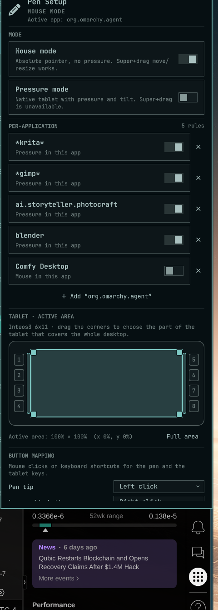

# Pen Setup — Wacom pen control for Omarchy

A bar widget + user daemon that turns a Wacom tablet into two switchable
personalities on [Omarchy](https://omarchy.org/) (Hyprland/Wayland):

- **Mouse mode** — absolute pointer, no pressure. Pen tip = left click, lower
  barrel button = right click, upper barrel button = middle click. Super+drag
  move and Super+middle-drag resize work like a normal mouse.
- **Pressure mode** — virtual tablet with pressure and tilt for Krita, GIMP,
  Inkscape, Xournal++ and anything else that wants a stylus.

Plus per-application rules, remappable pen/pad buttons (mouse, keyboard or
scroll), a draggable tablet→screen active-area crop, and both touch strips
mapped to smooth high-resolution scrolling with flick acceleration.

Free and open source under the [MIT license](LICENSE). No account, no
telemetry, no network access.



## Downloads

Grab the latest package from **[Releases](https://github.com/DanielBeaudryGIThub/pen-setup/releases/latest)**
(`Pen-Setup-<version>.zip`), or clone this repo. Both contain the same files.

## Features

| | |
|---|---|
| **Mouse / pressure mode** | One toggle switches the pen between a plain absolute pointer and a pressure+tilting virtual tablet. |
| **Per-application rules** | Switch modes automatically by window class (`*krita*`, `*gimp*`, `*inkscape*`, `*xournal*` are pre-seeded). Add the focused app from the panel with one click. |
| **Button mapping** | Pen tip, both barrel buttons, the 8 express keys and both touch strips — map each to a mouse action, a scroll action or a keyboard shortcut. |
| **Tablet active area** | Drag the corners in the panel to crop the tablet to the part of the screen you want. |
| **Touch strips** | Continuous high-resolution wheel events: a slow stroke scrolls ~24 notches, a quick flick accelerates up to ~2.2×. Sensitivity: Gentle / Normal / Fast / Very fast. |
| **Bar widget + menu row** | Lives on the right side of the Omarchy bar, and opens from Super+Space (search "pen"). |
| **CLI** | `wacom-pen-ctl` for scripts: mode, buttons, strips, area, status. |

## Requirements

- Omarchy 4.x on Hyprland (Wayland). Other Quickshell/Hyprland setups may work
  with small path changes.
- `python` with [`python-evdev`](https://python-evdev.readthedocs.io/):

  ```bash
  sudo pacman -S python-evdev
  ```

- A Wacom tablet. This was written for and tested on a **Wacom Intuos3 6×11
  (PTZ-631W)**; the device names in `files/.local/bin/wacom-pen-daemon.py`
  (`POINTER_NAME`, `TABLET_NAME`, `BUTTONS_NAME`, `KEYS_NAME`) are the only
  tablet-specific part — adjust them for other models.
- Your user must be able to read the tablet's `/dev/input/event*` nodes and
  create a `uinput` device (usually satisfied by the standard `input`/`uinput`
  udev rules on Arch; log out and back in after adding groups).

## Install

From a release zip:

```bash
cd ~/Downloads
unzip Pen-Setup-1.1.0.zip
cd Pen-Setup-1.1.0
./install.sh
```

Or from a clone:

```bash
git clone https://github.com/DanielBeaudryGIThub/pen-setup.git
cd pen-setup
./install.sh
```

The installer:

1. copies the plugin, daemon, CLI, systemd unit and default config into
   `~/.config` / `~/.local`;
2. adds `dbeaudry.pensetup` to the right side of the Omarchy bar (once — it
   will not duplicate the entry);
3. adds a **Pen Setup** row to the Super+Space menu (a `.bak` copy of the menu
   file is made first);
4. enables and starts `wacom-pen.service`;
5. restarts the Omarchy shell so the widget appears.

The installer is idempotent: re-running it keeps your existing
`~/.config/wacom-pen/config.json` and bar layout.

## Use

- Click the pen icon in the bar, or run
  `omarchy-shell dbeaudry.pensetup toggle`.
- **Mouse mode / Pressure mode** — the toggle at the top.
- **Per-application** — rules switch modes by window class when you focus an
  app. *Add "…"* uses the currently focused window class.
- **Tablet · Active area** — drag the corner handles to crop.
- **Button mapping** — pen tip, barrel buttons, express keys, touch strips.
- **Scroll sensitivity** — Gentle / Normal / Fast / Very fast.
- **Switch modes by app** — turn the per-app rules on or off.

### Touch strips

Both strips ship mapped identically (`Scroll up / down`, Normal) and behave the
same way: a stroke of the same length and speed scrolls the same distance on
either side. They emit high-resolution wheel events, so scrolling is smooth
rather than stepped; lifting the finger stops instantly. Either strip can be
set to vertical/horizontal, normal or inverted, or `none` from the panel,
independently of the other.

## CLI

```bash
wacom-pen-ctl status
wacom-pen-ctl set-mode mouse|tablet|native
wacom-pen-ctl set-button stylus "key:ctrl+z"
wacom-pen-ctl set-strip-sensitivity 1.75
wacom-pen-ctl reset-area
```

`wacom-pen-ctl status --json` prints the whole state for scripting.
Your settings live in `~/.config/wacom-pen/config.json`.

## Troubleshooting

- **Widget missing from the bar** — `omarchy restart shell` (a full shell
  restart is required after plugin changes; `rescanPlugins` alone is not
  enough).
- **Daemon exits with "virtual pointer not registered"** — another process may
  hold the pen; stop old helper scripts and restart
  `systemctl --user restart wacom-pen.service`.
- **Pressure apps see no pressure** — add a per-app rule for that app (the
  panel's *Add "…"* button uses the focused window class).
- **Golden cursor / no pointer** — make sure `python-evdev` is installed and
  the user can access the tablet's event devices.
- **A strip scrolls the opposite way** — set that strip to `Scroll down / up`
  (or `Scroll left / right`) in the panel; the two strips are configured
  independently.
- **Logs** — `journalctl --user -u wacom-pen.service -n 40`.

## Uninstall

```bash
./uninstall.sh            # keeps ~/.config/wacom-pen/config.json
./uninstall.sh --purge    # also removes the saved config
```

The `pensetup` row in `~/.config/omarchy/extensions/omarchy-menu.jsonc` is left
in place; delete it by hand if you want it gone.

## Project layout

```
install.sh                                  installer (bar + menu + service)
uninstall.sh                                remover (keeps config by default)
files/.local/bin/wacom-pen-daemon.py        the daemon (owns pen + pad)
files/.local/bin/wacom-pen-ctl              CLI used by the panel
files/.config/omarchy/plugins/dbeaudry.pensetup/
    manifest.json                           plugin manifest
    Panel.qml                               bar widget / panel UI
files/.config/systemd/user/wacom-pen.service
files/.config/wacom-pen/config.json         default settings
scripts/package.sh                          builds the release zip in dist/
docs/panel.png                              screenshot used above
```

## License

MIT — see [LICENSE](LICENSE).
